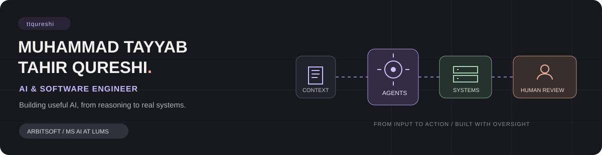
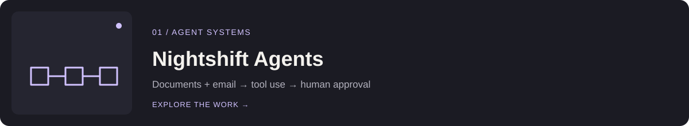
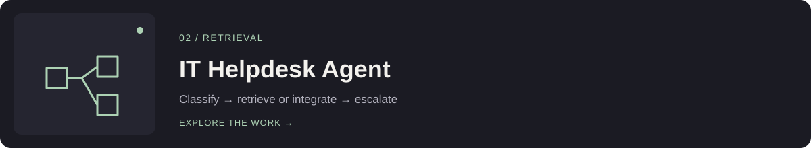
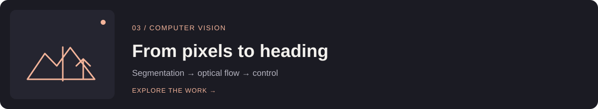
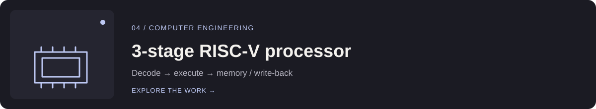

  <h1>Muhammad Tayyab Tahir Qureshi</h1>
  
<strong>AI &amp; Software Engineer</strong> &nbsp;·&nbsp; Lahore, Pakistan

  
<a href="https://tayyab-portfolio-delta.vercel.app/"><strong>Portfolio ↗</strong></a> &nbsp; | &nbsp; <a href="https://www.linkedin.com/in/ttqureshi/">LinkedIn ↗</a> &nbsp; | &nbsp; <a href="https://tayyab-portfolio-delta.vercel.app/assets/Muhammad-Tayyab-Tahir-Qureshi-CV.pdf">Download CV ↓</a> &nbsp; | &nbsp; <a href="mailto:m.tayyabtq@gmail.com">Email ↗</a>

I build AI systems that connect models to useful products: agents that use tools, retrieval pipelines that make knowledge accessible, and the backend infrastructure that brings it all together. I’m a **Software Engineer at Arbisoft** and an **MS Artificial Intelligence student at LUMS**.

### The systems I build

🟣 **Agents & orchestration** &nbsp; Tool use · Human approval · Auditable workflows  
🟢 **Retrieval & knowledge** &nbsp; RAG · Document ingestion · Semantic search  
🟠 **Backend & cloud** &nbsp; APIs · Async workers · AWS infrastructure  
🔵 **Applied ML** &nbsp; Computer vision · Segmentation · Perception & control

---

### Selected work

**[Nightshift Agents ↗](https://tayyab-portfolio-delta.vercel.app/#nightshift)** · Agent orchestration with a custom MCP gateway, Bedrock reasoning, human approval and audit logging.  
`Amazon Bedrock` `MCP` `n8n` `AWS ECS` `Terraform`  
Professional work at Arbisoft · portfolio case study

**[IT Helpdesk Agent ↗](https://tayyab-portfolio-delta.vercel.app/#helpdesk)** · A LangGraph system that routes requests through retrieval, integrations or escalation, with PostgreSQL checkpoints.  
`LangGraph` `ChromaDB` `FastAPI` `PostgreSQL`  
Professional work at Arbisoft · portfolio case study

**[From pixels to heading ↗](https://github.com/ttqureshi/Real-Time-Semantic-Segmentation-and-Vision-based-Heading-Controller)** · Semantic segmentation and optical flow feed a PD yaw controller.  
`PyTorch` `OpenCV` `PIDNet`  
Independent work · public repository

**[3-stage RISC-V processor ↗](https://github.com/ttqureshi/3-stage-pipelined-32-bit-Processor-RISC-V-ISA-)** · A pipelined processor implementation with interrupt handling and simulation tests.  
`SystemVerilog` `RISC-V`  
Independent work · public repository

---

### Tools I reach for

<strong>AI / ML</strong>

 &nbsp;&nbsp;&nbsp;  &nbsp;&nbsp;&nbsp;  &nbsp;&nbsp;&nbsp;  &nbsp;&nbsp;&nbsp; 

<strong>Backend</strong>

 &nbsp;&nbsp;&nbsp;  &nbsp;&nbsp;&nbsp;  &nbsp;&nbsp;&nbsp;  &nbsp;&nbsp;&nbsp; 

<strong>Infrastructure</strong>

 &nbsp;&nbsp;&nbsp;  &nbsp;&nbsp;&nbsp;  &nbsp;&nbsp;&nbsp; 

  
Interested in how these systems are built?

  
<a href="https://tayyab-portfolio-delta.vercel.app/#work"><strong>Explore the portfolio ↗</strong></a> &nbsp; · &nbsp; <a href="mailto:m.tayyabtq@gmail.com"><strong>Get in touch ↗</strong></a>

