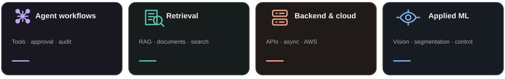
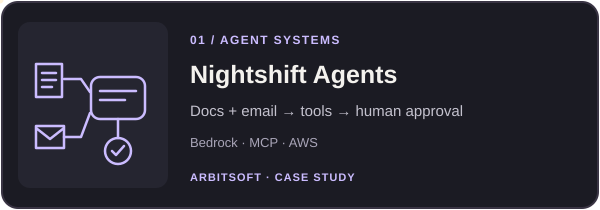
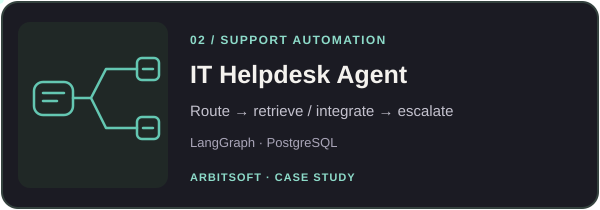
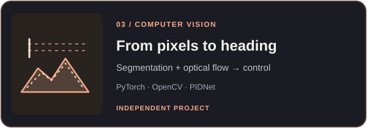
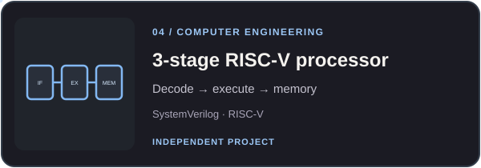

  <h1>Muhammad Tayyab Tahir Qureshi</h1>
  
<strong>AI &amp; Software Engineer</strong> &nbsp;·&nbsp; Lahore, Pakistan

  
<a href="https://tayyab-portfolio-delta.vercel.app/"><strong>Portfolio ↗</strong></a> &nbsp; | &nbsp; <a href="https://www.linkedin.com/in/ttqureshi/">LinkedIn ↗</a> &nbsp; | &nbsp; <a href="https://tayyab-portfolio-delta.vercel.app/assets/Muhammad-Tayyab-Tahir-Qureshi-CV.pdf">Download CV ↓</a> &nbsp; | &nbsp; <a href="mailto:m.tayyabtq@gmail.com">Email ↗</a>

I build AI systems that connect models to useful products: agents that use tools, retrieval pipelines that make knowledge accessible, and the backend infrastructure that brings it all together. I’m a **Software Engineer at Arbisoft** and an **MS Artificial Intelligence student at LUMS**.

### The systems I build

### Selected work

<table>
<tr>
<td width="50%" valign="top"></td>
<td width="50%" valign="top"></td>
</tr>
<tr>
<td width="50%" valign="top"></td>
<td width="50%" valign="top"></td>
</tr>
</table>

### Tools I reach for

<strong>AI / ML</strong>

 &nbsp;&nbsp;&nbsp;  &nbsp;&nbsp;&nbsp;  &nbsp;&nbsp;&nbsp;  &nbsp;&nbsp;&nbsp; 

<strong>Backend</strong>

 &nbsp;&nbsp;&nbsp;  &nbsp;&nbsp;&nbsp;  &nbsp;&nbsp;&nbsp;  &nbsp;&nbsp;&nbsp; 

<strong>Infrastructure</strong>

 &nbsp;&nbsp;&nbsp;  &nbsp;&nbsp;&nbsp;  &nbsp;&nbsp;&nbsp; 

  
Interested in how these systems are built?

  
<a href="https://tayyab-portfolio-delta.vercel.app/#work"><strong>Explore the portfolio ↗</strong></a> &nbsp; · &nbsp; <a href="mailto:m.tayyabtq@gmail.com"><strong>Get in touch ↗</strong></a>

